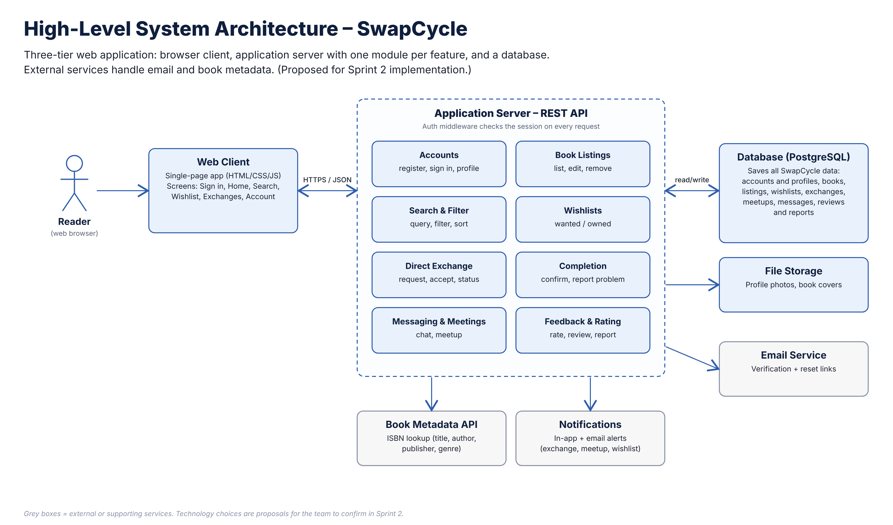
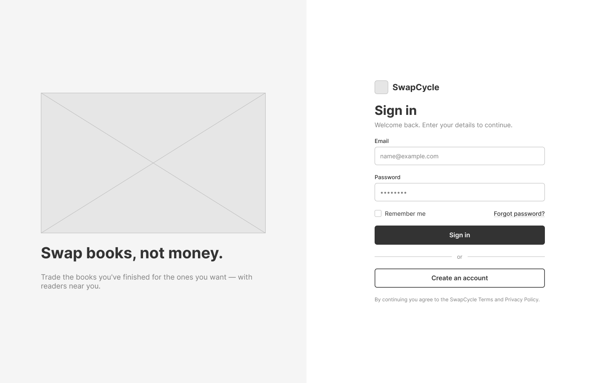
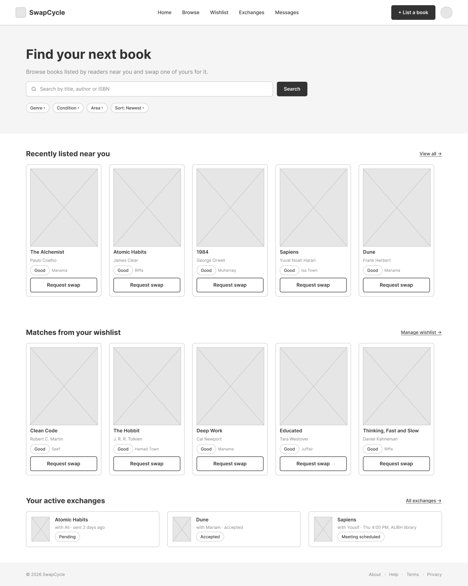
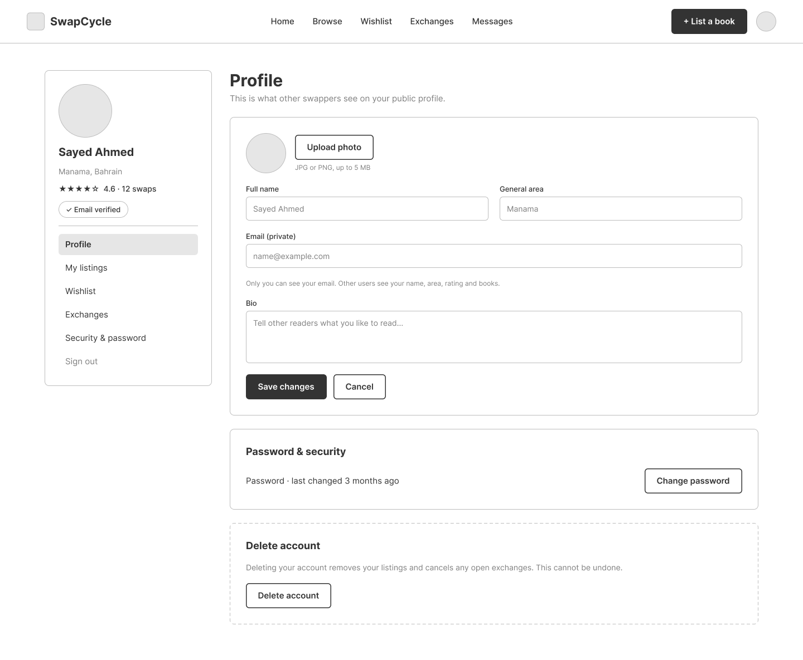
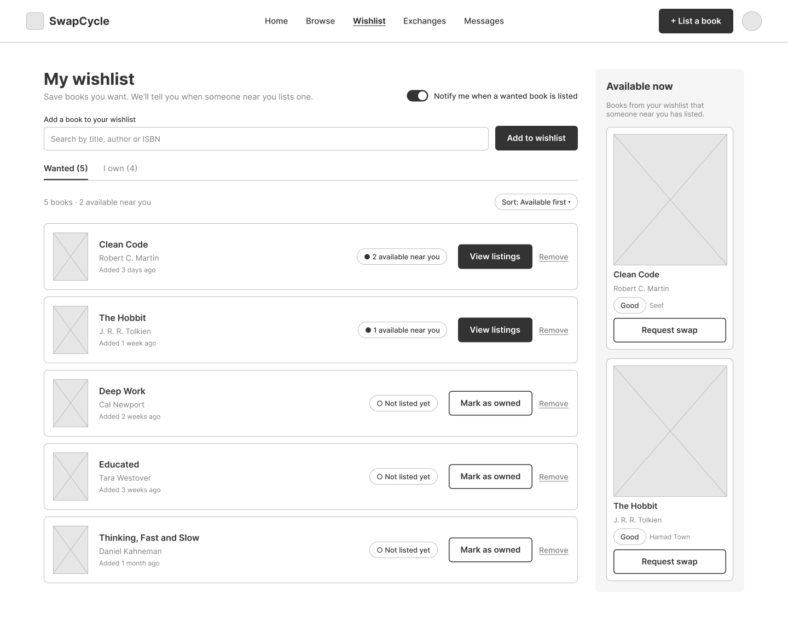
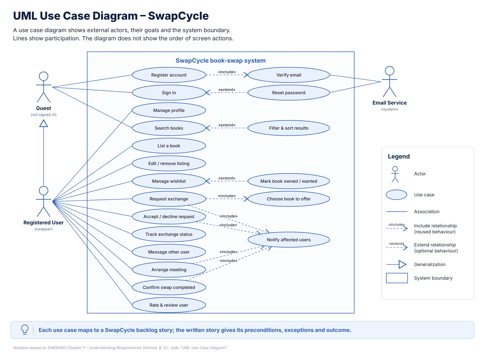
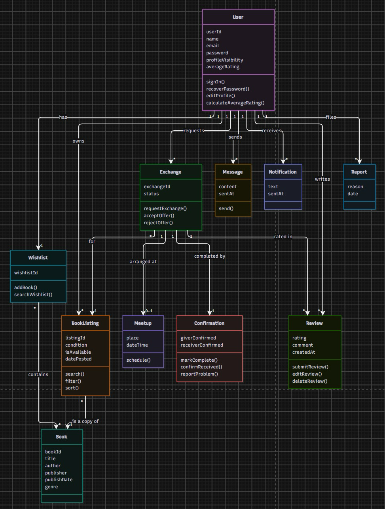
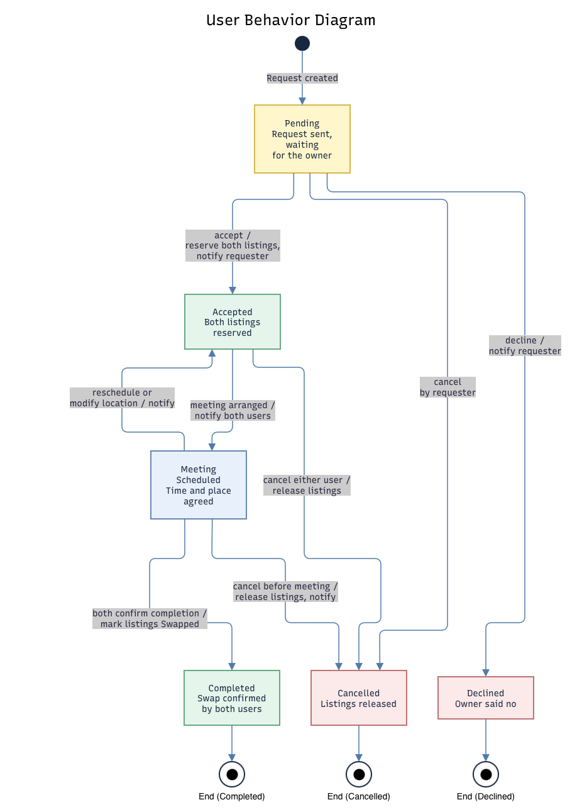
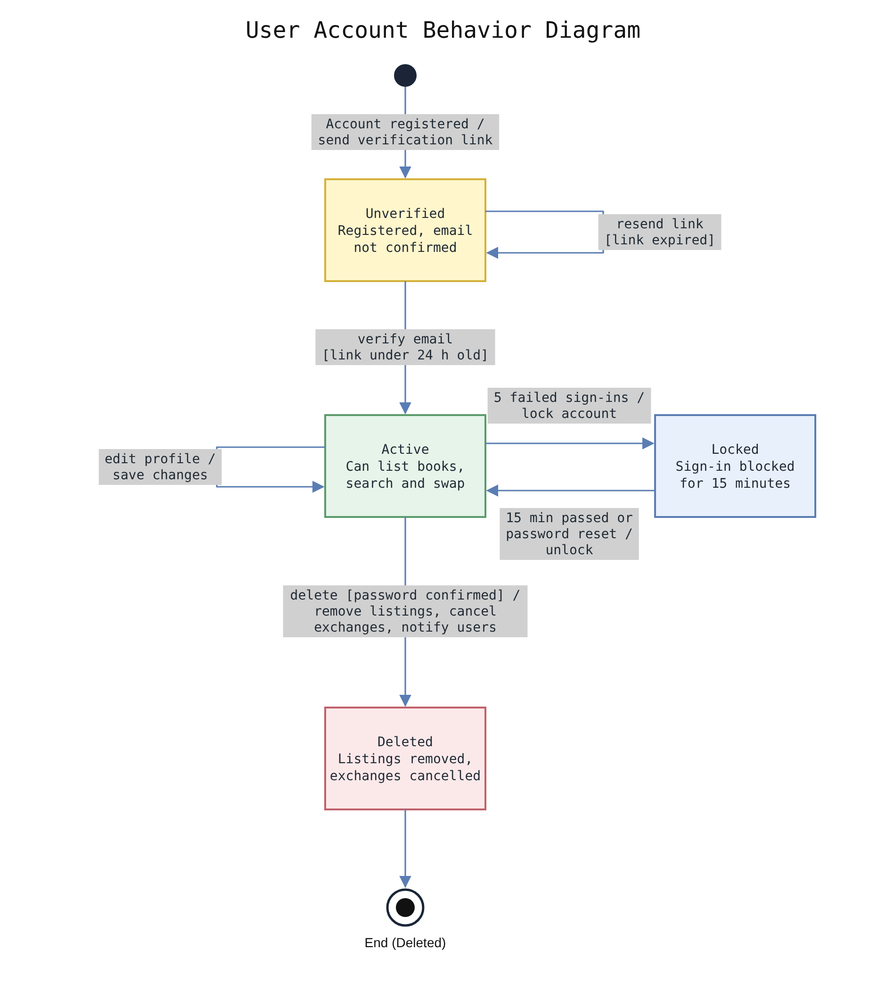

# Initial Design Documentation

Initial system design for SwapCycle, produced in Sprint 1.

## High-level architecture
Three-tier web application: a browser client, an application server with one module per feature, and a PostgreSQL database. Supporting services handle file storage, email, book metadata and notifications.

## Wireframes (Figma)
Main screens, designed in Figma by Sayed Ahmed.

| Sign in | Home (book listings) | Account / profile | Wishlist |
|---|---|---|---|
|  |  |  |  |

## Use case view
By Sayed Ali and Sayed Ahmed (Jira SCRUM-64 to SCRUM-71).

## Information view – class diagram
By Kareem and Amir (Jira SCRUM-72 to SCRUM-79).

## Behavior view – state diagrams
By Sayed Ahmed and Sayed Mohammed (Jira SCRUM-80 to SCRUM-87).

| Exchange request | User account |
|---|---|
|  |  |
