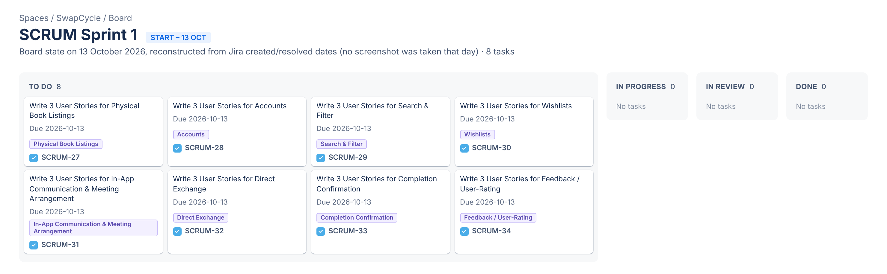
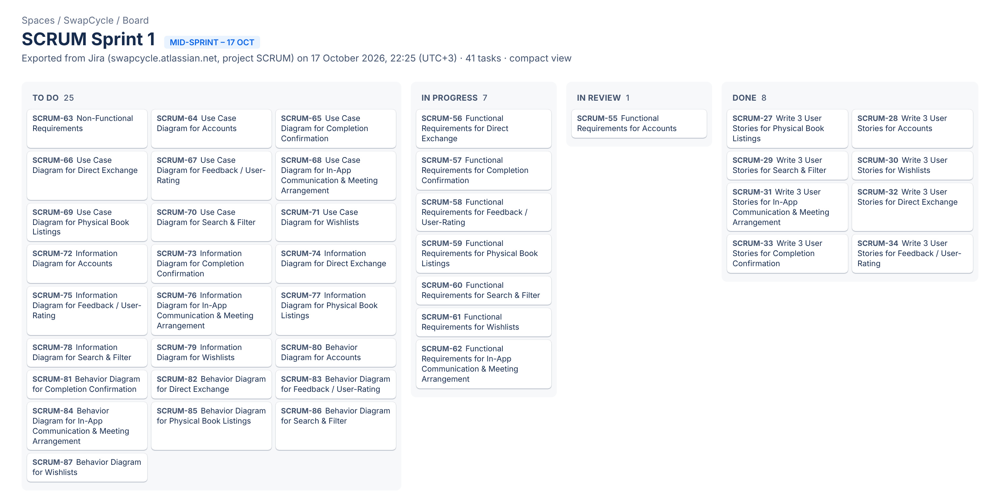
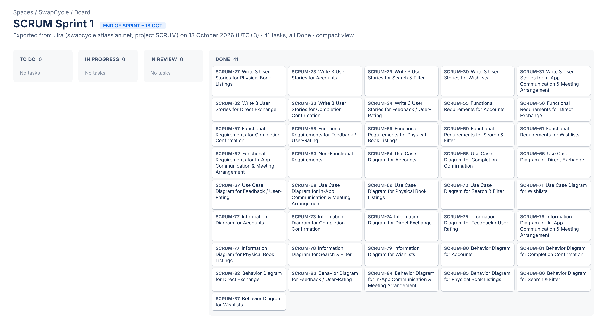

# Kanban Board Evidence

This folder contains timestamped screenshots showing the
progression of the team's board during Sprint 1.

## Required Screenshots
- Beginning of the sprint
- Middle of the sprint
- End of the sprint

## Suggested Filenames
- YYYY-MM-DD-sprint1-beginning.png
- YYYY-MM-DD-sprint1-middle.png
- YYYY-MM-DD-sprint1-end.png

## Board Information
Board link: https://swapcycle.atlassian.net (SwapCycle space → Board, project key SCRUM)
Tool used: Jira (moved from a Kanban board in Meeting 4)

Screenshots should clearly show task titles and their status.
The team should update the board regularly as work progresses.

## Sprint 1 Snapshots

### Beginning – 13 October 2026
The 8 user-story tasks in To Do. **Reconstructed from Jira created/resolved dates**; no screenshot was taken that day.

### Middle – 17 October 2026, 22:25
User-story tasks done, functional requirements in progress, diagram tasks still to do (Jira export).

| To Do | In Progress | In Review | Done |
|---|---|---|---|
| 25 | 7 | 1 | 8 |

### End – 18 October 2026
All 41 Sprint 1 tasks in Done (Jira export).

| To Do | In Progress | In Review | Done |
|---|---|---|---|
| 0 | 0 | 0 | 41 |

Full card list: [sprint1-board.md](sprint1-board.md). The images are rendered from the Jira exports so every card is visible; the live board scrolls. `2026-10-17-sprint1-board.png` is the original full-height export of the middle snapshot.
