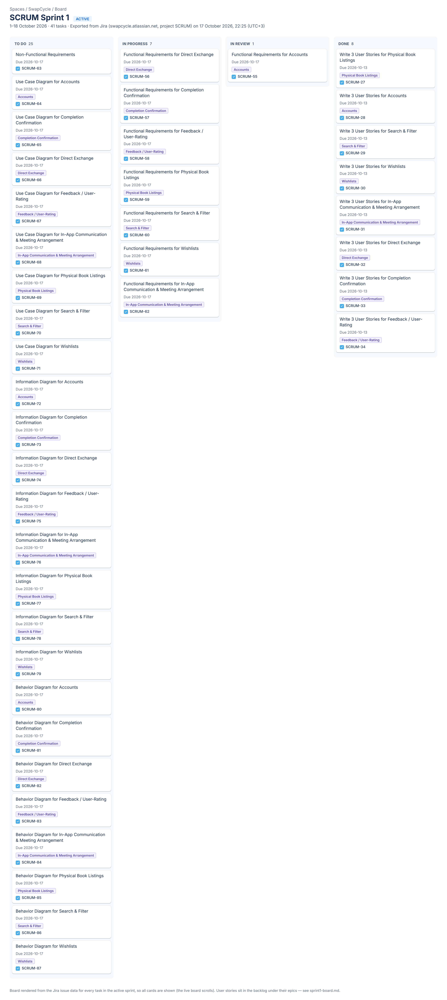

# Kanban Board Evidence

This folder contains timestamped screenshots showing the
progression of the team's board during Sprint 1.

## Required Screenshots
- Beginning of the sprint
- Middle of the sprint
- End of the sprint

## Suggested Filenames
- YYYY-MM-DD-sprint1-beginning.png
- YYYY-MM-DD-sprint1-middle.png
- YYYY-MM-DD-sprint1-end.png

## Board Information
Board link: https://swapcycle.atlassian.net (SwapCycle space → Board, project key SCRUM)
Tool used: Jira (moved from a Kanban board in Meeting 4)

Screenshots should clearly show task titles and their status.
The team should update the board regularly as work progresses.

## Sprint 1 Snapshots

### 17 October 2026 – end of sprint

| To Do | In Progress | In Review | Done |
|---|---|---|---|
| 25 | 7 | 1 | 8 |

Full card list (all 41 sprint tasks and the 23 backlog user stories): [sprint1-board.md](sprint1-board.md).
The image is rendered from the Jira export so every card is visible; the live board scrolls.

Beginning- and middle-of-sprint screenshots should be added from screenshots taken at the time.
