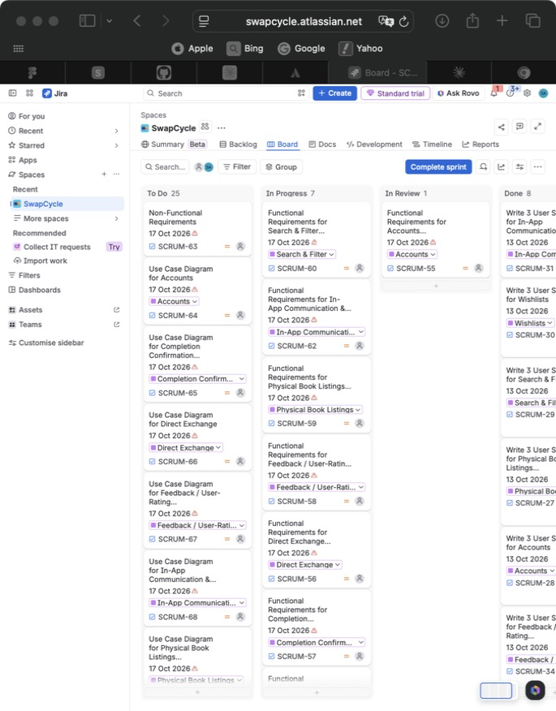

# Kanban Board Evidence

This folder contains timestamped screenshots showing the
progression of the team's board during Sprint 1.

## Required Screenshots
- Beginning of the sprint
- Middle of the sprint
- End of the sprint

## Suggested Filenames
- YYYY-MM-DD-sprint1-beginning.png
- YYYY-MM-DD-sprint1-middle.png
- YYYY-MM-DD-sprint1-end.png

## Board Information
Board link: https://swapcycle.atlassian.net (SwapCycle space → Board, project key SCRUM)
Tool used: Jira (moved from a Kanban board in Meeting 4)

Screenshots should clearly show task titles and their status.
The team should update the board regularly as work progresses.

## Sprint 1 Snapshots

### 17 October 2026 – end of sprint

| Column | Cards | Visible in screenshot |
|---|---|---|
| To Do | 25 | Non-Functional Requirements (SCRUM-63); Use Case Diagram for Accounts (SCRUM-64), Completion Confirmation (SCRUM-65), Direct Exchange (SCRUM-66), Feedback / User-Rating (SCRUM-67), In-App Communication (SCRUM-68), Physical Book Listings |
| In Progress | 7 | Functional Requirements for Search & Filter (SCRUM-60), In-App Communication (SCRUM-62), Physical Book Listings (SCRUM-59), Feedback / User-Rating (SCRUM-58), Direct Exchange (SCRUM-56), Completion Confirmation (SCRUM-57) |
| In Review | 1 | Functional Requirements for Accounts (SCRUM-55) |
| Done | 8 | Write 3 User Stories for In-App Communication (SCRUM-31), Wishlists (SCRUM-30), Search & Filter (SCRUM-29), Physical Book Listings (SCRUM-27), Accounts (SCRUM-28), Feedback / Rating (SCRUM-34) |

The beginning- and middle-of-sprint screenshots should be added from screenshots taken at the time.
