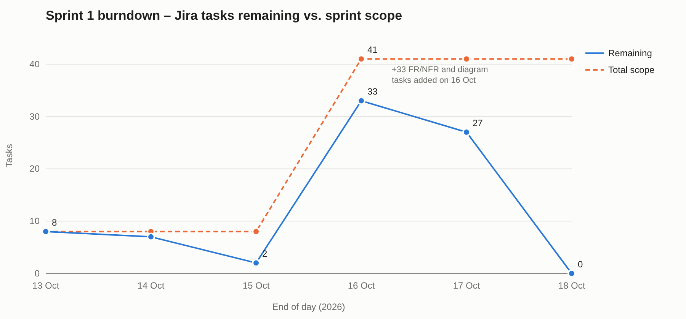

# Sprint 1 Report – Velocity and Impediments

Sprint 1 ran from 1 to 18 October 2026. Scrum Master: Sayed Ali. Product Owner: course instructor.

## Sprint goal
Finish the requirements analysis and initial design for SwapCycle: user stories, functional and non-functional requirements, three design diagrams and wireframes.

## Velocity
The team did not use story points in Sprint 1, so velocity is counted in tasks: **41 of 41 tasks completed**.

| End of day | 13 Oct | 14 Oct | 15 Oct | 16 Oct | 17 Oct | 18 Oct |
|---|---|---|---|---|---|---|
| Tasks remaining | 8 | 7 | 2 | 33 | 27 | 0 |
| Total scope | 8 | 8 | 8 | 41 | 41 | 41 |

Scope jumped from 8 to 41 on 16 October when the requirement and diagram tasks were added, and most of the work closed in the last two days. For Sprint 2 the team will estimate stories in points and load all tasks at the planning meeting so the burndown starts at full scope.

## Impediment log

| Date | Impediment | Action taken | Status |
|---|---|---|---|
| 6 Oct | Sayed Mohammed absent from Meeting 2 | Briefed on agreed features before Meeting 3 | Resolved |
| 11 Oct | Kanban board hard to keep current | Moved all tracking to Jira | Resolved |
| 13 Oct | Exchange stories not drafted | Deadline set for 15 Oct, rechecked at Meeting 7 | Resolved 15 Oct |
| 13 Oct | Accounts stories created in a personal Jira site | Recreated in the SwapCycle project (SCRUM-44–46) | Resolved |
| 17 Oct | FR/NFR tasks past their 17 Oct due date | Finished 17–18 Oct | Resolved |
| 17 Oct | Not every member had committed to GitHub | Action from Meeting 8: every member commits | In progress |

Meeting records: [../meetings](../meetings) · Board: [../kanban](../kanban)
