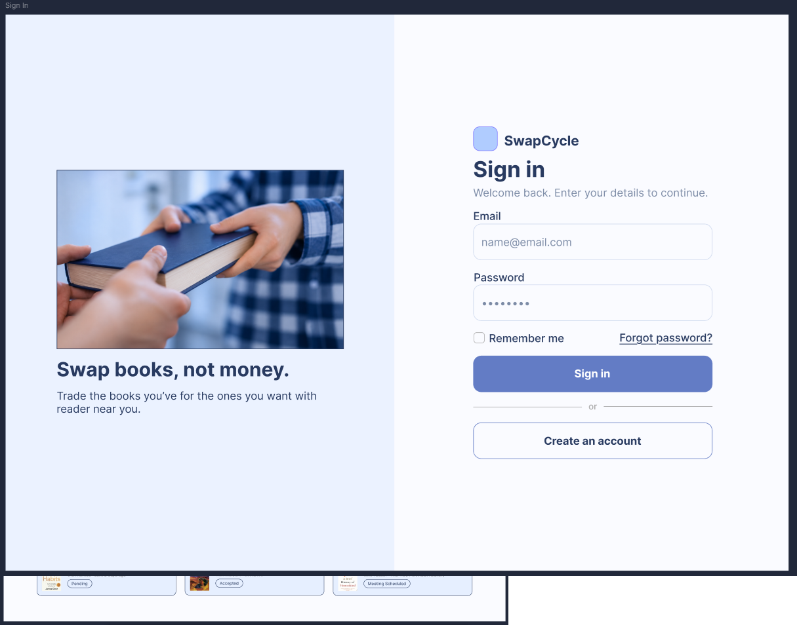
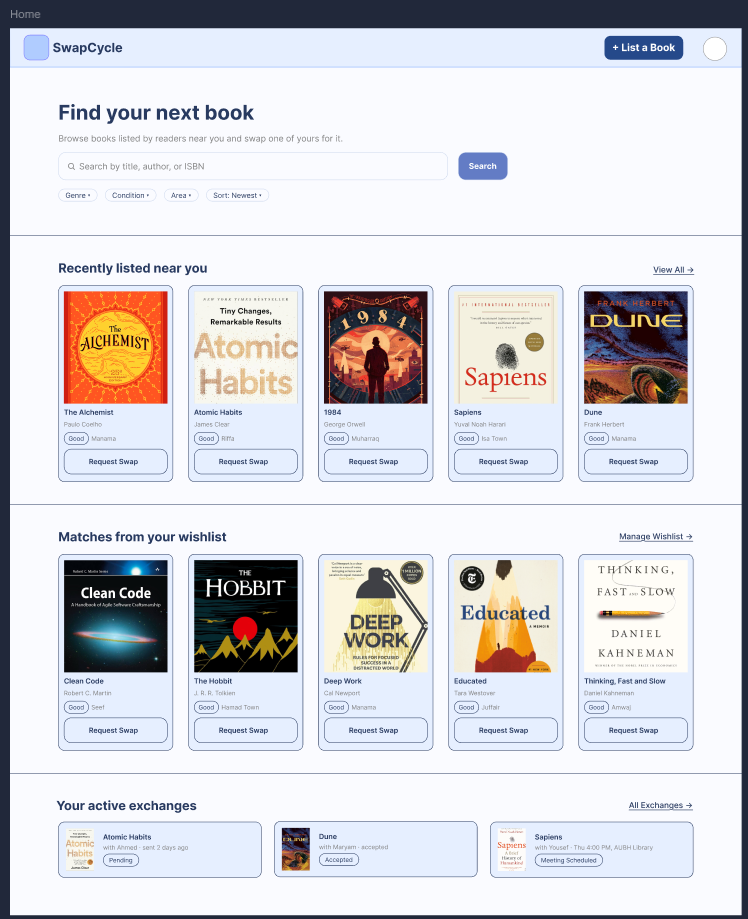
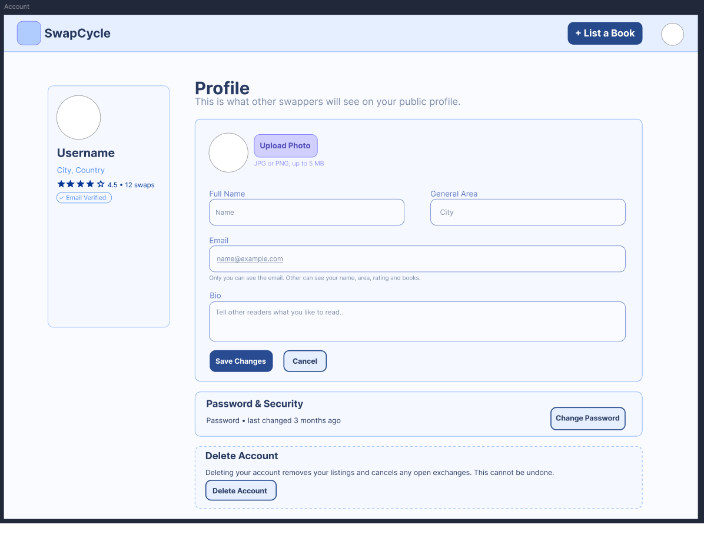
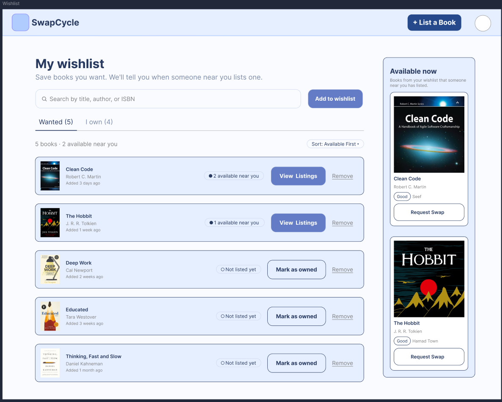

# Sprint 2 Wireframes 
Figma: [paste Figma link] 
User flow: Sign in → Home (search or wishlist matches) → Request Swap → Your active exchanges (Pending → Accepted → Meeting Scheduled) 
| Screen | Stories | File | 
|---|---|---| 
| Sign in | SCRUM-45 |  | 
| Home | SCRUM-38, 39, 40, 49 |  | 
| Account | SCRUM-44, 46 |  |
| Wishlist | SCRUM-19, 41, 43 |  |
